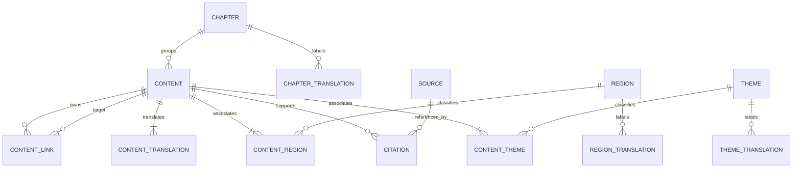

# PostgreSQL history schema design

## Status and scope

The normalized schema is now applied by
[003_normalize_history.ts](../server/migrations/003_normalize_history.ts).
The canonical DDL is [server/schema/history.sql](../server/schema/history.sql);
[history-schema.sql](./history-schema.sql) points to that source.

The database normalizes history data while retaining stable text content IDs
and the existing six content kinds. Authentication remains managed by Better
Auth. Membership, comments and administrative audit records are not replaced.
The DDL uses `history_design` as a template namespace. The migration substitutes
the current application schema (`public` locally), retaining the existing
Better Auth user table for reviewer identities. Tests use isolated schemas.
The original JSONB content table is retained as `content_legacy`, not written
by the application. The `content_read` view reconstructs the existing API shape
from normalized rows; it is not another copy of the data.

## Entity relationships



| Table | Responsibility |
| --- | --- |
| `content` | Identity, kind, publication, chapter, structured dates, primary classification, editorial review and revision |
| `content_translation` | Title, summary, body, optional date note and review per language |
| `chapter`, `region`, `theme` | Stable editorial taxonomy identifiers |
| Taxonomy translation tables | Localized labels; no duplicated content records |
| `content_region`, `content_theme` | Many-to-many associations |
| `source` | Shared bibliographic reference |
| `citation` | Entry-specific claim, source reference and display order |
| `content_link` | Related records or ordered collection members |

People and institutions are `content` records with their own translations,
citations and relationships, not separate duplicate biographies. Add subtype
tables only when structured biographical or institutional fields are actually
needed. A collection is a content record plus ordered `collection_item` links.

## Core invariants

- Every entry has an English original and at least one region and theme.
  Deferred composite foreign keys enforce that primary classifications are
  present in the corresponding association tables.
- Five locale identifiers match the application: `en`, `zh-Hans`, `zh-Hant`,
  `ja`, `ko`. Missing translations are absent rows, not empty placeholders.
- Dates use signed historical integers: `-1` means 1 BCE and `1` means 1 CE.
  Year zero is forbidden. Ranges sort by their start, require an end, and
  cannot run backward. Precision applies to the year, not a precise day.
  Month/day detail can remain in translated date notes until separately scoped.
- Events require dates and citations. Published people/institutions require
  citations. Articles and news may have none, preserving current behavior.
- Source identity includes URL, title, author and publication, not URL alone:
  different bibliographic descriptions must not be silently merged.
  A citation's claim belongs to the entry, not to the reusable source.
  A generated SHA-256 identity avoids PostgreSQL B-tree entry-size failures
  for long multilingual bibliography fields. The repository verifies all
  identity fields on conflict and rejects a hash collision rather than merging.
- Self-links and duplicate targets are forbidden. Related links are directional
  records; reverse browsing is computed. Collections use positive, unique
  positions. Related links also retain their supplied order. Gaps in positions
  are allowed; order remains explicit.
- Publication and editorial review are independent. New reviewed states have a
  timestamp and authenticated reviewer. Imported flags without provenance use
  `legacy_review=true`, preserving status without inventing a timestamp.
  Reviewer IDs may become null after account deletion,
  retaining a timestamp without retaining the deleted identity.
- Relationship targets cannot be hard-deleted until incoming links are
  explicitly removed. Prefer unpublishing over deleting historical records.

The deferred integrity triggers validate citation requirements and collection
link types at commit. Writers must use transactions for a parent record and
its translations, associations, citations and links. Application validation
still enforces collection size limits, permitted operations, URL parsing,
review permissions, and field-level error messages.

## Review and revision workflow

Use `revision` for optimistic concurrency:

```sql
UPDATE public.content
SET revision = revision + 1, updated_at = now(), editorial_status = 'draft',
    reviewed_by = NULL, reviewed_at = NULL, legacy_review = false
WHERE id = $1 AND revision = $2
RETURNING revision;
```

No returned row means missing content or a conflicting edit, not success.
Keep this update and all child edits in one transaction. Text edits reset that
translation's review; date, classification, link and citation edits reset
editorial review. Only authorized administrators can mark a revision reviewed.
Write the actor, operation, content ID and revision to the existing audit
workflow. Review state resets and revision increments are service-layer
responsibilities, not automatically implemented by the DDL. The publishing UI
sends its loaded revision; the API returns `409 EDIT_CONFLICT` for stale saves.
API clients without a revision retain legacy last-write-wins compatibility.

During migration, existing `reviewed` flags have no known actor or timestamp.
Do not manufacture provenance: their flags are retained with `legacy_review`,
and actor/time remain unknown. Re-review records a real timestamp and clears
that legacy marker. Original values also remain in `content_legacy`.

## Public browsing and access

All public queries must filter `content.published=true`. Join against a
published target when resolving links, and never expose draft IDs or bodies in
API responses or social previews. An unpublished collection hides its reading
path. A published collection may reference a draft, but that target is omitted
from public reading results without changing stored order.

Use the requested translation when present and otherwise the English original,
with an explicit fallback indicator. Apply the same choice to search:

```sql
SELECT c.id, COALESCE(local.title, original.title) AS title,
       (local.content_id IS NULL) AS translation_fallback
FROM public.content c
JOIN public.content_translation original
  ON original.content_id=c.id AND original.locale='en'
LEFT JOIN public.content_translation local
  ON local.content_id=c.id AND local.locale=$1
WHERE c.published
  AND strpos(lower(COALESCE(local.title,original.title) || ' ' ||
                       COALESCE(local.summary,original.summary) || ' ' ||
                       COALESCE(local.body,original.body)),lower($2))>0
  AND ($3::text IS NULL OR EXISTS (
    SELECT 1 FROM public.content_region r
    WHERE r.content_id=c.id AND r.region_id=$3))
ORDER BY c.start_year NULLS LAST,c.id
LIMIT $4 OFFSET $5;
```

Use parameterized queries throughout. Basic literal substring search works for
CJK text without assuming whitespace segmentation. B-tree indexes support
classification and chronological queries, not arbitrary substring search.
For a larger corpus, benchmark `pg_trgm` indexes or a dedicated multilingual
search engine; do not assume PostgreSQL English full-text tokenization handles
Chinese, Japanese and Korean. Use cursor pagination as volume grows.

This schema does not grant client database access or implement RLS. Keep
database credentials server-side, grant a least-privilege application role,
and retain server-side membership and administrator checks.

## Compatibility mapping and migration plan

| API / legacy field | Normalized storage |
| --- | --- |
| `content.id`, `kind`, `published`, `created_at` | Same fields in normalized `content` |
| `translations[locale]` | One `content_translation` row per locale |
| `year`, `history.dates` | `start_year`, `end_year`, `date_precision`; one source of truth |
| `date_label` | `original_date_note` |
| `translations[locale].dateLabel` | Translation `date_note` |
| `region`, `category` | Primary region/theme plus association rows |
| `history.regions`, `history.themes` | Association rows |
| `history.chapter` | `chapter_id` |
| `sources[]` | Deduplicated `source` plus ordered `citation` rows |
| `history.relatedIds[]` | Related links or positioned collection links |
| Review flags | Review fields, with provenance rules described above |

1. Back up and verify a restore of the current database.
2. Inventory invalid/zero dates, missing English translations, absent source
   references, dangling links, and unsupported taxonomy IDs. Report conflicts;
   do not silently drop content or reinterpret uncertain dates.
3. Rename the old table to `content_legacy`, create normalized tables and
   backfill in one versioned transaction. Keep IDs stable.
4. Backfill each content aggregate transactionally. Use primary classifications
   as associations if legacy history metadata is missing. Preserve source
   order, collection order, dates, public visibility and text.
5. Compare counts, text, associations, links and citation order. Reconstruct
   current API shapes from normalized rows to avoid breaking the React app.
6. Switch content routes, publishing, seeding and source queries together.
   Reads use `content_read`; writes use the transactional content repository.
   Keep comments attached to the same IDs; retarget their FK to the new content
   table at cutover. Keep Better Auth and membership schema unchanged.
7. Validate direct URLs, multilingual search, draft privacy, moderation and
   sharing, then remove legacy storage only after a verified rollback window.

These steps have been implemented locally. The migration performs a preflight,
then compares every reconstructed entry with its legacy aggregate before commit:
IDs, timestamps, translations, dates, citations, classifications and link order
must agree. Region/theme association order and omitted empty optional source
fields are semantically normalized; draft translation review is made explicit.

Taxonomy translation tables are seeded in all five locales using the same
shared labels as the UI. Repeated seeding does not overwrite existing rows.
The current UI still uses the shared label catalog; taxonomy editing is not
implemented.

## Backup and rollback

Before migration, the local database was dumped in PostgreSQL custom format and
restored successfully into a dedicated temporary database. That verification
database was removed afterward; the archive remains in the session artifacts
directory. No credentials or dump contents are committed to this repository.

For future upgrades, stop application writers, take a fresh dump and restore it
into a separate database to verify it before changing the live schema. Use
`npm run db:migrate` rather than executing the canonical DDL directly.
Migration failures roll back schema and content changes together.

If rollback is necessary after commit, restore the verified archive into a
**new database**, validate it, then configure the matching pre-migration code
and connection before restarting. Do not blindly rename `content_legacy` back:
new normalized edits and new content are not reflected in that snapshot.
Export/reconcile post-migration writes before reverting to an older backup.
Retain the legacy table and backup until the rollback window is closed.

Once migration 003 has been applied, add subsequent changes in new numbered
migrations; do not edit the canonical DDL to change existing installations.
